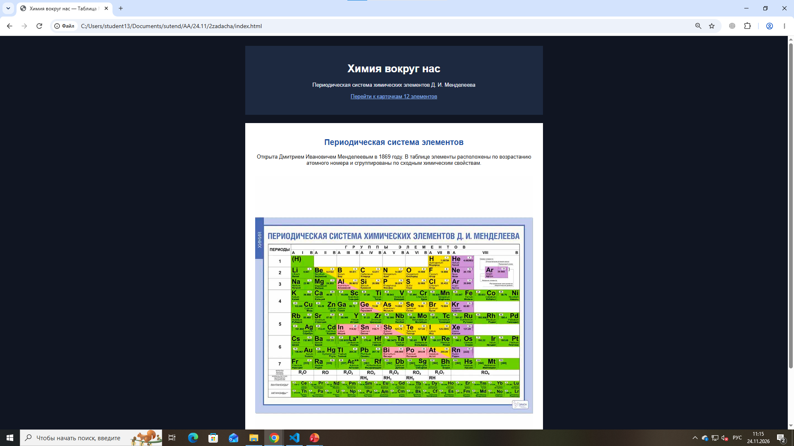
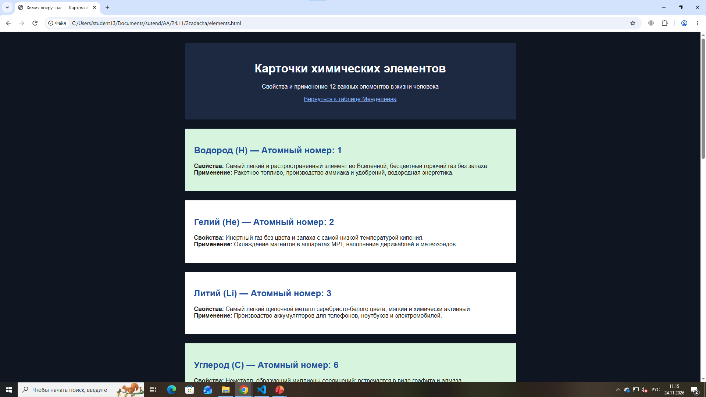

# Автор
* Ананьев Александр, группа 12ТЭС

# Химия вокруг нас

Двухстраничный учебный сайт на HTML и CSS: таблица Менделеева и описание 12 химических элементов.

## Файлы проекта
* `index.html` — главная страница с периодической системой элементов.
* `elements.html` — страница с карточками 12 элементов (символ, номер, свойства и применение).
* `style.css` — файл стилей для оформления страниц и блоков.
* `PLAN.md` — план обновления с v1.0 до v1.1 и инструкция по откату.
* `image/README/` — скриншоты интерфейса.

## Запуск
1. Скачайте репозиторий: `git clone https://github.com/PKO-LP/ximia_24_11`
2. Откройте `index.html` в браузере.

## Версии
* **v1.0** — базовая версия с таблицей Менделеева и карточками 12 элементов.
* **v1.1** — добавлено выделение 4 элементов жизни (H, C, N, O) через класс `.bio-block`, оформлены `PLAN.md`, `README.md` и скриншоты.
* **v1.1 (fix)** — исправлен контраст выделения карточек (светло-зелёный фон `#d7f5de`), улучшена читаемость ссылки в шапке (`.header a`) и обновлены скриншоты.
* **v1.1 (fix)** — обновил скриншоты в README
* **v1.1 (fix)** — многокрадные обновление README
## Скриншоты
* Таблица Менделеева: 
* Карточки элементов: 
