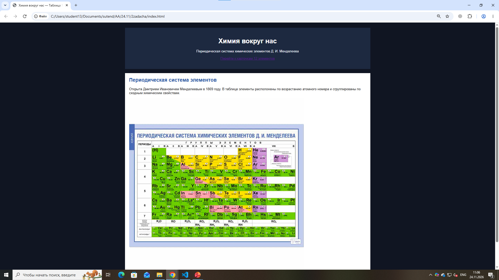
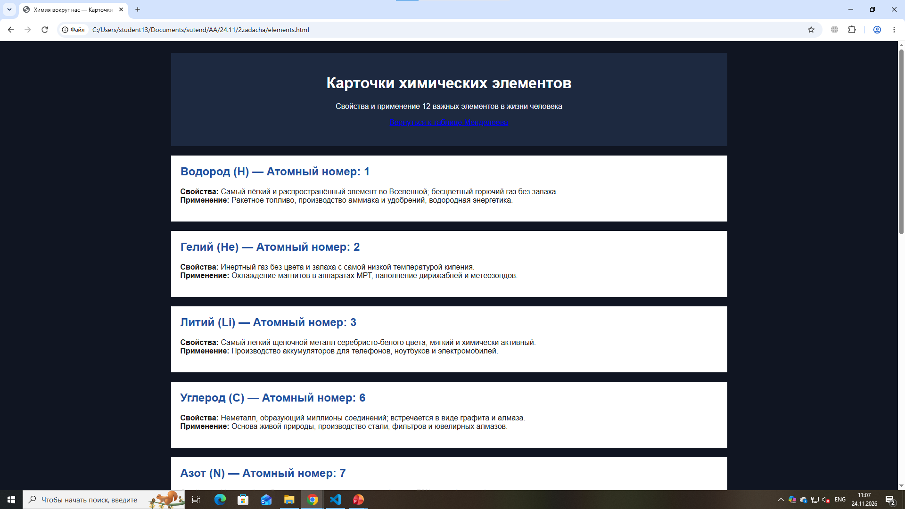

# Автор
* Ананьев Александр, группа 12ТЭС

# Химия вокруг нас

Двухстраничный учебный сайт на HTML и CSS: таблица Менделеева и описание 12 химических элементов.

## Файлы проекта
* `index.html` — главная страница с периодической системой элементов.
* `elements.html` — страница с карточками 12 элементов (символ, номер, свойства и применение).
* `style.css` — файл стилей для оформления страниц.
* `PLAN.md` — план обновления с v1.0 до v1.1.
* `screenshots/` — скриншоты интерфейса.

## Запуск
1. Скачайте репозиторий: `git clone https://github.com/PKO-LP/ximia_24_11.git`
2. Откройте `index.html` в браузере.

## Версии
* **v1.0** — базовая версия с таблицей Менделеева и карточками элементов.
* **v1.1** — добавлено цветовое выделение 4 элементов жизни (H, C, N, O) через класс `.bio-block`.

## Скриншоты
* Таблица Менделеева: 
* Карточки элементов: 
